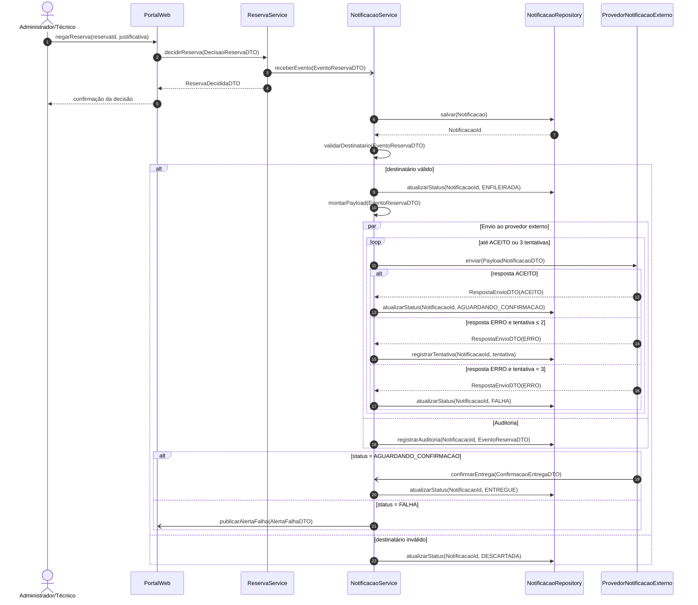
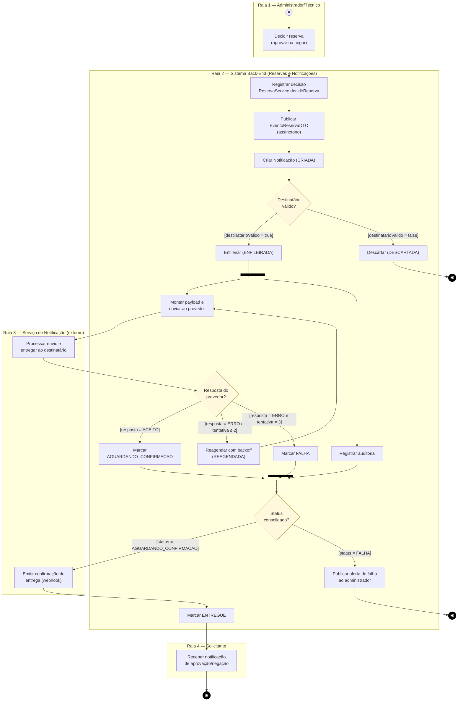
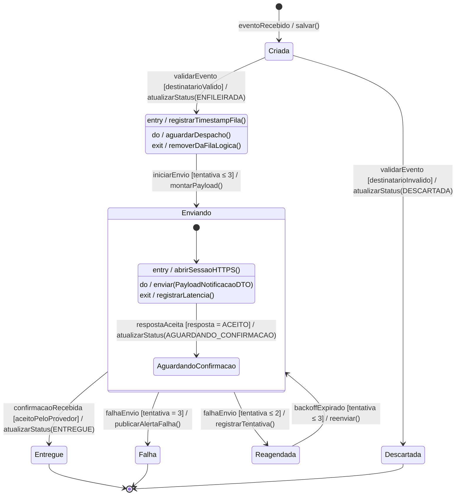

# APS 3 — Dossiê de Arquitetura Viva: Componente Notificações (FabLab Manager)

**Aluno:** Nome Sobrenome · **Curso:** Engenharia de Software (4º Período) · **UC:** Modelagem de Software

## 1. Funcionalidade crítica

**Disparo e entrega confiável de notificações de decisão de reserva** (aprovação/negação). Quando o administrador/técnico decide uma reserva, o Componente Reservas publica um evento. O Componente Notificações valida o destinatário, persiste a notificação, envia ao Serviço de Notificação externo com retry e acompanha a confirmação de entrega. O mesmo componente atende eventos de Estoque e Compras (interface `INotificacao` do C4 de componentes do projeto).

Rastreabilidade: RF25 (enviar notificações), regra de negócio 6 (negação com justificativa) e entidade de domínio **Notificação**.

> Nota: a seta `-)` do Mermaid representa mensagem assíncrona. No sistema real ela é publicada via RabbitMQ (ver ADR 0001 e C4).

## 2. Diagrama de Sequência

### Consistência mensagem × operação pública

| Linha de vida (B) | Operações públicas declaradas | Mensagens recebidas no diagrama |
|---|---|---|
| PortalWeb | `negarReserva(reservaId, justificativa)`, `publicarAlertaFalha(AlertaFalhaDTO)` | 1, `publicarAlertaFalha` |
| ReservaService (`IReservaService`) | `decidirReserva(DecisaoReservaDTO): ReservaDecididaDTO` | `decidirReserva` |
| NotificacaoService (`INotificacaoService`) | `receberEvento(EventoReservaDTO): void`, `validarDestinatario(EventoReservaDTO): boolean`, `montarPayload(EventoReservaDTO): PayloadNotificacaoDTO`, `confirmarEntrega(ConfirmacaoEntregaDTO): void` | as quatro |
| NotificacaoRepository (`INotificacaoRepository`) | `salvar(Notificacao): NotificacaoId`, `atualizarStatus(NotificacaoId, Status): void`, `registrarTentativa(NotificacaoId, int): void`, `registrarAuditoria(NotificacaoId, EventoReservaDTO): void` | as quatro |
| ProvedorNotificacaoExterno (`IProvedorNotificacao`) | `enviar(PayloadNotificacaoDTO): RespostaEnvioDTO` | `enviar` |

## 3. Diagrama de Atividades com Raias

## 4. Diagrama de Transição de Estados — entidade `Notificacao`

**Invariantes protegidos:** (1) `Entregue`, `Falha` e `Descartada` são terminais, sem transição de saída; (2) `Entregue` só é alcançada após resposta `ACEITO` do provedor; (3) no máximo 3 tentativas; (4) confirmações duplicadas em estado terminal são ignoradas (idempotência por `eventoId`).

## 5. Visão Arquitetural C4 Nível 3 (Componentes)

Código em [`docs/architecture/c4-componentes.puml`](docs/architecture/c4-componentes.puml) (C4-PlantUML). Renderize com a extensão PlantUML do VS Code ou no plantuml.com e salve o PNG em `docs/architecture/c4-componentes.png`; depois referencie aqui:

``

## 6. Registro de Decisão Arquitetural

Veja [`docs/architecture/adr-0001.md`](docs/architecture/adr-0001.md).

## 7. Correspondência entre modelos

| Sequência | Atividades | Estado da `Notificacao` |
|---|---|---|
| `salvar` | Criar Notificação | Criada |
| `validarDestinatario` | Destinatário válido? | Criada → Enfileirada / Descartada |
| `par` + `enviar` | Fork → enviar / auditar | Enfileirada → Enviando |
| `registrarTentativa` | Reagendar com backoff | Reagendada |
| `atualizarStatus(FALHA)` + `publicarAlertaFalha` | Marcar FALHA + alerta | Falha |
| `confirmarEntrega` | Emitir confirmação (webhook) | Entregue |